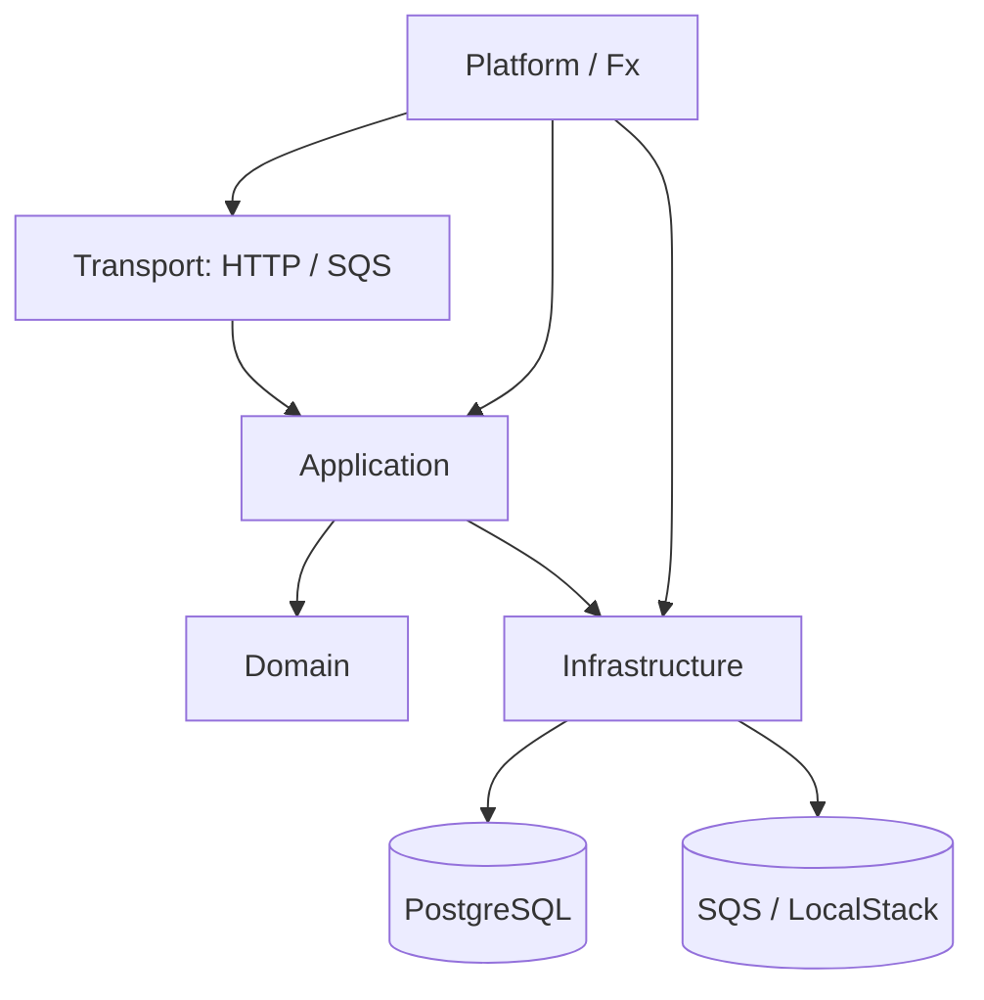
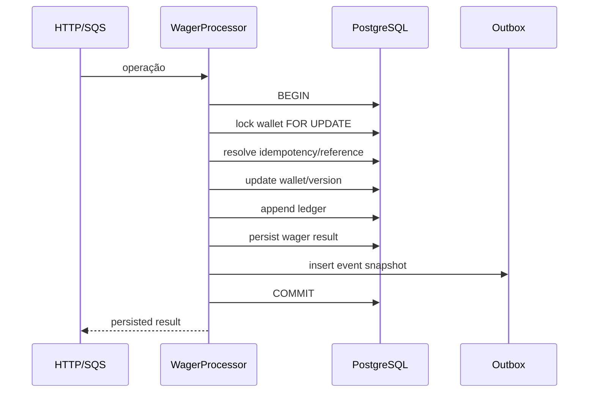
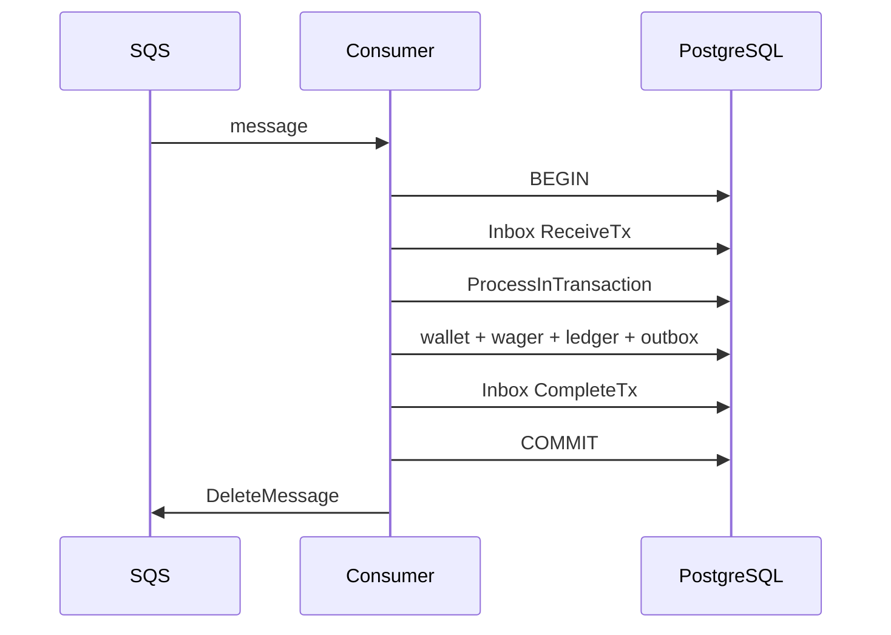
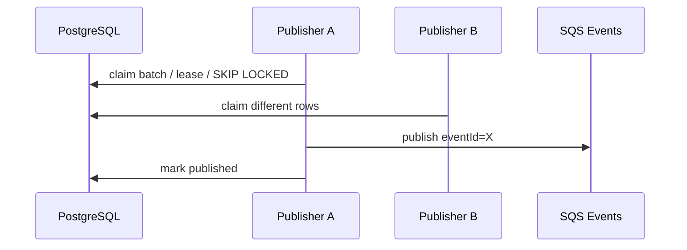

# Arquitetura e decisões técnicas

## 1. Objetivo

O sistema processa operações financeiras de wagering por HTTP e SQS com as mesmas regras de negócio. A prioridade é preservar invariantes financeiras mesmo com redelivery, concorrência, múltiplos processos e falhas entre commit e publicação de eventos.

## 2. Camadas

`domain` não depende de HTTP, SQS ou PostgreSQL. `application` coordena os casos de uso. `infrastructure` implementa persistência, mensageria e OIDC. `platform/app` compõe dependências com Fx.

## 3. Money

`Money` armazena `int64 minorUnits` + moeda. A entrada textual exige `^[0-9]+\.[0-9]{2}$` (com as validações adicionais do domínio) e moeda uppercase de três letras.

Consequências:

- nenhum cálculo financeiro usa `float`;
- comparação e soma verificam moeda;
- overflow é rejeitado;
- respostas voltam a usar string decimal.

## 4. Transação financeira e lock

O lock pertence ao PostgreSQL. Por isso processos diferentes coordenam a mesma wallet, enquanto wallets diferentes podem avançar em paralelo.

## 5. Idempotência

A idempotência tem duas identidades persistentes:

- `Idempotency-Key`;
- `(providerId, externalTransactionId)`.

O hash SHA-256 é calculado sobre `application.WagerPayload` canônico. HTTP e SQS chamam a mesma função, evitando semânticas diferentes por transporte.

Replay equivalente reutiliza o resultado persistido. Payload divergente ou tentativa de reutilizar a external transaction com outra chave produz conflito.

## 6. SQS + Transactional Inbox

Se a transação SQL falhar, Inbox e domínio são revertidos juntos. Se o processo cair depois do commit e antes do `DeleteMessage`, a redelivery encontra a Inbox concluída e não reaplica o efeito financeiro.

`PENDING_REFERENCE` é uma conclusão durável da mensagem de entrada; a continuação é desacoplada da mensagem original.

## 7. Outbox

O payload da Outbox é snapshot imutável do evento. Claims possuem lease e podem ser recuperados após abandono. Falhas recebem backoff.

Se a publicação em SQS funcionar e o `mark published` falhar, o registro volta a ser elegível após o lease e é republicado com o mesmo `eventId`. Consumidores downstream devem tratar `eventId` como chave de deduplicação.

## 8. Referências pendentes

`REFUND`, `ROLLBACK` e `WIN` com referência podem depender de uma transação que ainda não chegou. Nessa situação a transação pode ficar `PENDING_REFERENCE`.

O worker implementado:

- busca item devido com claim transacional;
- procura a referência por provider + external transaction;
- valida a referência;
- reprocessa quando possível;
- aplica backoff exponencial;
- limita tentativas a 8;
- rejeita com código estável quando expira ou esgota retries.

Backoff implementado: base de 5 segundos, dobrando até o limite interno do algoritmo.

O worker é iniciado pelo lifecycle Fx da aplicação. Ele executa uma passagem imediatamente no startup e continua em polling periódico; o shutdown cancela o contexto e aguarda o loop terminar antes de fechar o pool PostgreSQL.

## 9. OAuth2/OIDC

Keycloak emite tokens de client credentials. A API verifica:

- issuer;
- assinatura via JWKS;
- audience `jungle-api`;
- claim `provider_id`.

O provider autenticado é comparado com o `providerId` do payload e com a propriedade persistida da wallet/transação.

Health e metrics são públicos; rotas de negócio passam pelo middleware de autenticação.

## 10. Reconciliação

A reconciliação lê wallet + ledger em visão consistente e calcula:

`difference = storedBalance - calculatedBalance`

A operação é somente leitura. Divergência é reportada na resposta e incrementa métrica; não há correção automática de saldo.

## 11. Observabilidade

Logs usam JSON estruturado. O correlation ID vem de `X-Correlation-ID` ou é criado pela API.

Readiness depende de PostgreSQL e SQS. Liveness representa o processo.

As métricas são mantidas em memória por processo e expostas no formato Prometheus. Em execução com múltiplas instâncias, a agregação é responsabilidade do scraper/monitoramento externo.

## 12. Modelo de falhas

| Falha | Recuperação |
|---|---|
| HTTP repetido | idempotência persistente |
| SQS redelivery | Inbox + idempotência |
| concorrência na mesma wallet | row lock PostgreSQL |
| processos concorrentes | coordenação no DB |
| commit antes de publish | Outbox pendente |
| publish antes de confirmação | republish com mesmo `eventId` |
| publisher morre com claim | lease expira e outro worker recupera |
| referência ainda inexistente | `PENDING_REFERENCE` + retry/backoff |
| PostgreSQL/SQS indisponível | readiness falha / operação não é confirmada |

## 13. Isolamento de identidade da wallet

A migration `000010` introduziu `provider_id` e o índice único `(provider_id, player_id, currency)`. A migration `000011` remove a constraint histórica global `(player_id, currency)`, permitindo que providers independentes usem o mesmo identificador externo de player e a mesma moeda sem colisão entre tenants.

Wallets legadas sem histórico inequívoco de provider permanecem com `provider_id=NULL`; isso evita inventar ownership durante a migration.
